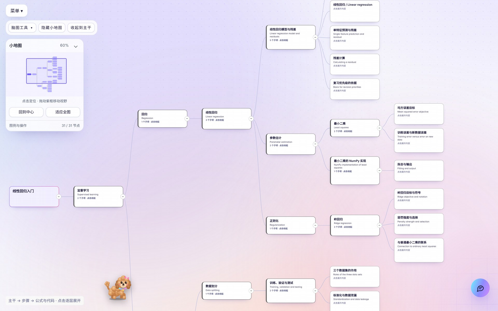
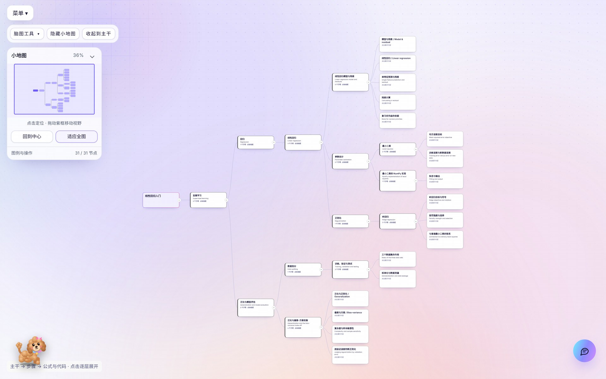
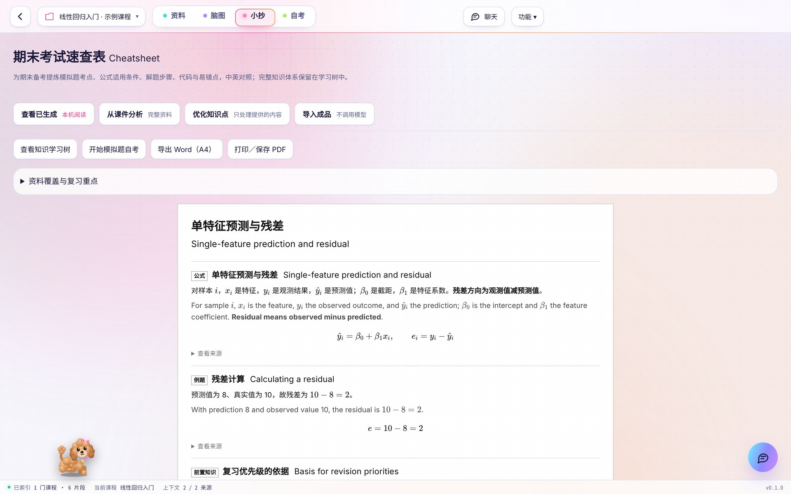
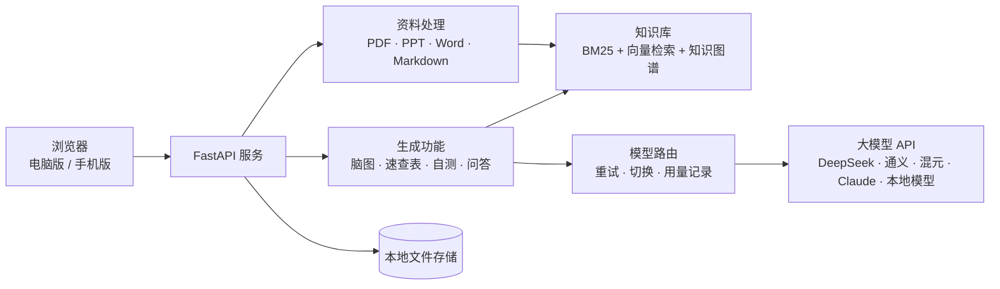

# 黑豆课程学习

把散落的课件，理成一条清楚的复习路线。

黑豆课程学习是一个 AI 课程复习网页。上传课件（PDF、PPT、Word、Markdown）后，它会整理出课程脑图、期末速查表和自测题，还能基于课件回答问题，并标出每个回答来自哪份资料。电脑和手机都能用。

> **关于源码**：本仓库只用于展示项目，放的是介绍和效果截图；源代码保存在私有仓库，暂不公开。如需查看代码或在线演示，请通过我简历上的联系方式联系我。

## 主要功能

- **课件导入**：支持 PDF、PPT、Word、Markdown。自动切分、建立检索索引，并逐页记录哪些内容已被覆盖。
- **课程脑图**：按「主干 → 步骤 → 公式与代码」组织知识点，节点中英双语，可逐层展开，带小地图导航；手机上可拖动、双指缩放。
- **期末速查表（小抄）**：汇总考点、公式适用条件、解题步骤和易错点，中英对照；可导出 A4 Word（公式为可编辑的 Word 公式）或打印成 PDF。
- **自测**：根据课件出题，选完答案立即显示解析，逐项说明每个选项对在哪里、错在哪里。
- **问答**：结合关键词检索、向量检索和知识图谱回答问题，回答附带资料出处。
- **手机版**：单独设计的点按式界面，配合粒子动效；系统开启「减少动画」时自动减弱动效。
- **多模型**：通过统一接口接入 DeepSeek、通义千问、混元、Claude 或本地模型，可在设置里随时切换；每次调用的 token 用量和费用都有记录。

## 效果截图

截图使用人工编写的「线性回归」示例课程，不包含任何真实课件内容。

**课程脑图全图**：31 个知识点按主干、步骤、公式与代码分层，左上角的小地图可以快速定位。

**期末速查表**：考点、公式与例题中英对照，可导出 Word 或 PDF。

## 技术架构

## 技术栈

| 部分 | 使用的技术 |
|---|---|
| 后端 | Python、FastAPI、Uvicorn、Pydantic |
| 前端 | React 18（esbuild 预编译）、D3、KaTeX、PDF.js、CodeMirror、tsParticles |
| 检索 | FAISS 向量检索、BM25、jieba 中文分词、NetworkX 知识图谱 |
| 文档处理 | python-pptx、python-docx、Markdown 解析 |
| 模型接入 | OpenAI 兼容接口、Anthropic 接口 |
| 部署 | Ubuntu、systemd、Nginx |

## 实现要点

- **两阶段知识抽取**：先从课件中提取主题，再细化到具体概念，合并成知识图谱，脑图和检索都基于它。
- **长任务进度**：上传处理和批量生成按阶段流式返回进度，界面显示真实阶段和预计剩余时间。
- **公式处理**：网页上用 KaTeX 渲染 LaTeX；导出或复制到 Word 时转换成 Word 原生公式，可以继续编辑。
- **模型路由**：同一套代码对接多家模型服务，配置热更新、失败重试，并按模型统计 token 用量和费用。
- **部署与安全**：提供 Linux 一键安装脚本（systemd + Nginx）；网站有访问密码保护，密码用 scrypt 哈希保存，登录凭证带签名，连续输错会被限速。
- **前端性能**：页面资源提前编译、全部本地托管、不依赖外部 CDN；后台轮询在页面隐藏时暂停，空闲时逐步放慢。

## 来源与致谢

- 本项目在开源项目 [nano-NotebookLM](https://github.com/ArthurYangX/nano-NotebookLM)（Apache-2.0）的基础上二次开发，新增了中文界面、脑图大纲、期末速查表、即时解析自测、手机版、服务器部署和访问控制等功能。
- 第三方组件：[tsParticles](https://github.com/tsparticles/tsparticles)（MIT）、[PDF.js](https://github.com/mozilla/pdf.js)（Apache-2.0）、[KaTeX](https://github.com/KaTeX/KaTeX)（MIT）、[React](https://github.com/facebook/react)（MIT）、[D3](https://github.com/d3/d3)（ISC）。
- 本仓库的文字和截图保留所有权利。
